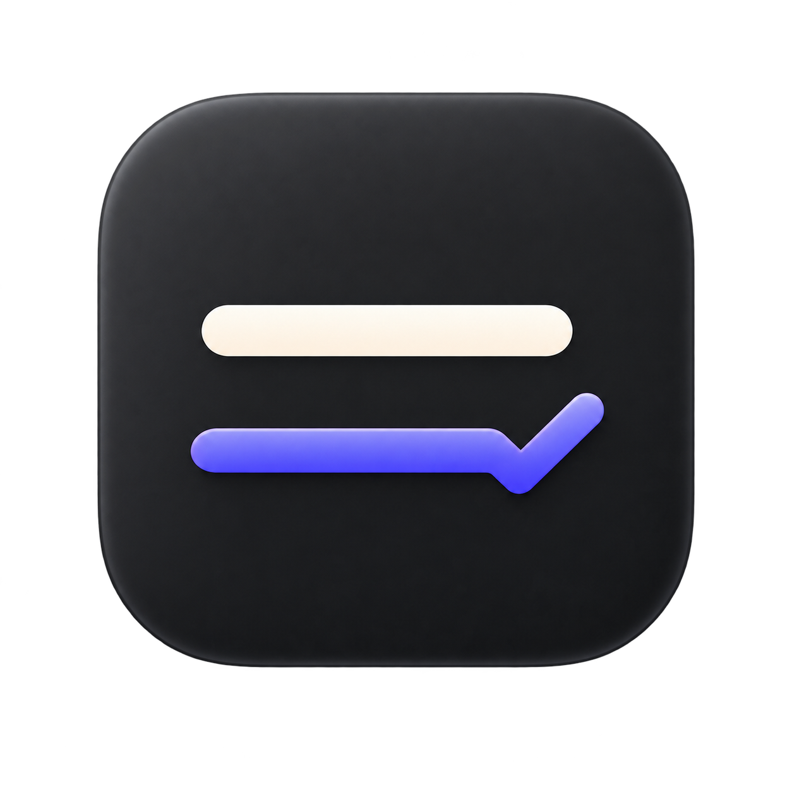

# Mend 2.0

<p align="center">
  
</p>

<p align="center"><strong>Correct selected text anywhere on macOS with real-time streaming, smart diffs, and local AI support.</strong></p>

<p align="center">
  <a href="https://mend.itsneel.com">Website</a> ·
  <a href="https://github.com/Neel2107/Mend/releases/latest">Download</a>
</p>

<p align="center">
  <a href="https://github.com/Neel2107/Mend/actions/workflows/ci.yml"></a>
  <a href="LICENSE"></a>
</p>

Mend is a native, ultra-responsive macOS writing assistant. Select text in any application, press a global shortcut, and Mend enhances it in place using your preferred local or cloud AI provider.

## What's New in Mend 2.0

- **⚡ Real-Time Streaming Preview:** Watch corrections stream smoothly token-by-token via Server-Sent Events (SSE) directly inside the floating glass capsule.
- **🔍 Ghost Diff HUD:** Instant word-level diff analysis (`+X, -Y` words) powered by a high-speed Myers/LCS diff engine before committing changes.
- **🛡️ Isolated Transient Pasteboard:** Marked with `org.nspasteboard.TransientType`, `org.nspasteboard.AutoGeneratedType`, and concealed data types so clipboard history managers (Raycast, Paste, Maccy, Alfred) never pollute your clipboard.
- **🦙 Native Local & Ollama Support:** Out-of-the-box local model integration (`llama3.2:3b`, `qwen2.5-coder`, `mistral`) with zero API keys required and instant offline fallback.
- **🧠 App-Aware Context Adaptation:** Automatically classifies active apps to adapt rewrite instructions:
  - **Code Editors & Terminals (Xcode, VS Code, Cursor, Zed):** Strictly preserves code symbols, backticks, camelCase variables, and markdown.
  - **Chat Apps (Slack, Discord, Messages):** Maintains natural, conversational tone without bureaucratic stiffness.
  - **Document & Mail Apps (Mail, Pages, Word, Notes):** Enforces elegant phrasing and professional clarity.
- **🏷️ Protected Custom Vocabulary:** Save brand names, acronyms, and specialized jargon in Settings that Mend will never modify or misspell.
- **⏪ Persistent Undo Vault:** Undo any replacement instantly with **⌃⌥Z** or the menu bar item. History is saved locally with atomic persistence.

## Features

- Corrects grammar, spelling, punctuation, and phrasing in place
- Works across macOS applications through customizable global shortcuts
- Supports OpenAI, Gemini, Ollama (Local), and custom OpenAI-compatible endpoints
- Falls back to another configured provider when a request fails
- Stores API keys securely in macOS Keychain
- Multi-action workflow: fix grammar, shorten, polish, translate, or format
- Compact, unobtrusive floating HUD styled with Liquid Glass on macOS 26 and ultra-thick material on macOS 13+
- Restores original clipboard contents immediately after replacement
- Runs quietly in the background, accessible from the menu bar, Spotlight, or Raycast

## Requirements

- Apple silicon Mac
- macOS 13 or later
- An API key for OpenAI / Gemini, or a local server running Ollama / LM Studio
- Accessibility permission for reading and replacing selected text

## Installation

Install from Terminal:

```sh
curl -fsSL https://mend.itsneel.com/install | sh
```

The installer verifies the release checksum and installs Mend into `/Applications`. Launch it with `open /Applications/Mend.app`.

Run the same command again to update. To install by hand instead, download `Mend-app-aarch64-apple-darwin.tar.gz` from [GitHub Releases](https://github.com/Neel2107/Mend/releases/latest), extract it, and move **Mend** into **Applications**. If macOS blocks the first launch, allow Mend under **System Settings → Privacy & Security → Open Anyway**.

For Gatekeeper, permissions, and release details, see the [installation guide](docs/INSTALL.md).

## Setup

1. Open **Mend Settings** from the app or menu-bar icon.
2. Choose **OpenAI**, **Gemini**, **Ollama (Local)**, or **Custom**.
3. If using cloud providers, paste your API key. If using Ollama, ensure your local instance is running (`ollama run llama3.2:3b`).
4. Allow Mend under **System Settings → Privacy & Security → Accessibility**.
5. Configure your shortcuts under **Actions** (default is **Control–Option–G**).
6. Optionally configure **Protected Vocabulary** and toggles for **Streaming** and **Ghost Diff**.

Mend keeps every provider key in one macOS Keychain item. When macOS asks whether Mend may use it, choose **Always Allow** so it does not ask again after updates. Turn on **Open Mend at login** in Settings to keep it running after a restart.

## Usage

1. Select text in any application.
2. Press the shortcut of the action you want.
3. Mend analyzes context, streams the correction, calculates the diff, and replaces the selection in place.
4. If you ever need to restore your original text, press **Control–Option–Z** or click **Undo Last Mend Replacement** in the menu bar.

Press the shortcut again while a request is running to cancel it. You can hide the menu-bar icon from Settings without disabling the global shortcut.

Choose **Check for Updates…** from the menu-bar icon to compare your version with the latest GitHub release.

## Build from source

Xcode Command Line Tools and Swift 5.10 or later are required.

```sh
git clone https://github.com/Neel2107/Mend.git
cd Mend
chmod +x Scripts/*.sh
./Scripts/run.sh
```

Build a signed app bundle in `dist/` with:

```sh
./Scripts/build-app.sh
```

## Privacy

- API keys are stored locally in macOS Keychain.
- Local models (Ollama) run 100% offline on your machine with zero external network requests.
- Mend does not include analytics, telemetry, user accounts, or a hosted backend.
- Temporary clipboard operations use transient markers to avoid polluting clipboard history managers.

## License

Mend is available under the [MIT License](LICENSE).
